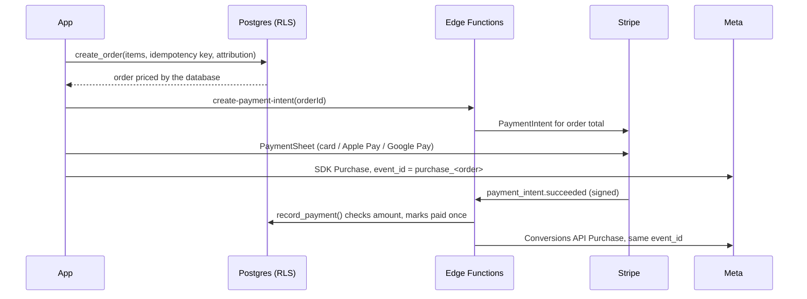

# Marketplace: roles, payments and Meta attribution in React Native

[](https://github.com/techsavvysenior/expo-marketplace-payments/actions/workflows/ci.yml)

A React Native (Expo) marketplace sample with Supabase. Customers buy physical goods with a card, Apple Pay, Google Pay or PayPal. Merchants list products and see their payouts. Admins assign roles and flag refunds. Premium is an App Store and Google Play subscription. Purchases are reported to Meta from both the device and the server, and Meta counts each one once.

The point of the sample is where each rule lives. Prices, permissions and "is this order paid" are decided by Postgres and by webhooks, never by the app.

## What it shows

**Roles enforced in the database.** `customer`, `merchant` and `admin` live in `user_roles`. A Supabase Custom Access Token Hook copies the role into the JWT as `user_role`, and `authorize(permission)` checks it inside row-level security policies and functions. The app reads the same claim only to decide which tabs to show. A unit test parses the SQL migration and fails if the TypeScript role model drifts from it.

**Server-side pricing.** `create_order()` reads prices from `products`, merges duplicate lines, rejects inactive products, mixed currencies and buying your own listing, and takes a 10% platform fee. The app sends product ids and quantities, never amounts. An idempotency key tied to the cart's contents means a retry after a timeout or a cancelled payment sheet reuses the same order.

**Three payment paths, one rule set.**

| Path | Used for | Who marks it paid |
|---|---|---|
| Stripe PaymentSheet (card, Apple Pay, Google Pay) | Physical goods | `stripe-webhook` on `payment_intent.succeeded` |
| PayPal Orders v2 in an auth session browser | Physical goods | `paypal-order` after a server-side capture |
| App Store / Google Play via RevenueCat | Subscriptions, digital goods | `revenuecat-webhook` writes `entitlements` |

Digital goods are refused by `create_order()` (`DIGITAL_GOODS_REQUIRE_IN_APP_PURCHASE`), because Apple and Google require their own billing for them.

`record_payment()` is the only way an order becomes paid. It runs with the service role, records the provider's event id first so a redelivered webhook is a no-op, and refuses an amount, currency or provider that doesn't match the order.

**Meta App Events plus the Conversions API.** The app logs `Purchase` through `react-native-fbsdk-next` with an `event_id`. When the webhook confirms the payment, the server sends the same event through the Conversions API with the same `event_id`, so Meta deduplicates them. The server event carries hashed email and user id, the SDK's install id, and `app_data` with the App Tracking Transparency result. The advertising id is only sent when the person allowed tracking. The SDK starts with auto-init and auto-logging off, so nothing is sent before the app decides to.

**Classes with seams.** `src/core` has no React Native imports. `CheckoutService` depends on `PaymentGateway`, `OrdersApi`, `AnalyticsSink` and `ConsentProvider` interfaces; `src/platform` has the Stripe, PayPal, Meta and RevenueCat implementations, chosen in one composition root (`src/features/services.tsx`). The Edge Functions import the same core modules, so the Conversions API payload, PayPal client and RevenueCat signature check are written once and unit-tested in Node.

## Architecture



```
src/
  core/            Plain TypeScript, shared with the Edge Functions
    money.ts         Integer cents, no float drift, no mixed currencies
    cart.ts          Immutable cart, order payload, content fingerprint
    roles.ts         Role model mirrored from SQL, token claim reader
    errors.ts        AppError hierarchy the UI switches on
    payments/        PaymentGateway interface, CheckoutService
    analytics/       CommerceEvent, Analytics fan-out, shared event ids
    meta/            Conversions API payload builder and client
    paypal/          PayPal Orders v2 client (server side)
    webhooks/        RevenueCat HMAC verification and parsing
  platform/        Stripe, PayPal, Meta SDK, ATT consent, RevenueCat adapters
  features/        Auth (role from token), composition root, TanStack Query hooks
  app/             expo-router screens; tabs depend on role
supabase/
  migrations/      Roles, RLS, pricing, payments, entitlements
  functions/       create-payment-intent, stripe-webhook, paypal-order, revenuecat-webhook
  tests/           Postgres tests run in process with PGlite
```

## Who can do what

| | Customer | Merchant | Admin |
|---|---|---|---|
| Browse and buy | Yes | Yes, not own products | Yes |
| List and edit products | No | Own only | Any |
| See orders | Own | Orders containing their products, their lines only | All |
| Request a refund | No | No | Paid orders |
| Assign roles | No | No | Others only, audited |

Hidden tabs are a convenience. Each row above is enforced by a policy or function and covered by a database test.

## Run it

Requires Node 22.18 or later, a Supabase project, and test accounts for Stripe, PayPal sandbox, RevenueCat and a Meta app. The payment and Meta SDKs are native modules, so use a development build, not Expo Go.

```bash
npm install
cp .env.example .env                                     # app keys
cp supabase/functions/.env.example supabase/functions/.env   # server secrets

supabase link --project-ref <your-ref>
supabase db push
supabase secrets set --env-file supabase/functions/.env
supabase functions deploy --use-api
```

`--use-api` lets the CLI bundle the shared files in `src/core` that the functions import. Then, in the Supabase dashboard, enable the Custom Access Token hook (Authentication, Hooks) with `public.custom_access_token_hook`. `supabase/config.toml` does the same for local development.

Point the Stripe webhook at `.../functions/v1/stripe-webhook` for `payment_intent.succeeded` and `payment_intent.payment_failed`, and the RevenueCat webhook at `.../functions/v1/revenuecat-webhook` with HMAC signing on. Both functions are deployed without JWT verification because their signatures are the authentication.

```bash
npx expo run:ios       # or run:android
```

Make yourself an admin once from the SQL editor, then manage roles in the app:

```sql
update public.user_roles set role = 'admin' where user_id = '<your user id>';
```

## Tests

```bash
npm run typecheck
npm run lint
npm test               # unit tests: core classes, gateways, error mapping
npm run test:db        # Postgres tests: roles, RLS, pricing, payments, entitlements
npm run check:functions    # Deno type check of the Edge Functions
```

The database tests apply the real migrations to Postgres running in process (PGlite), with a small stub of the Supabase auth schema and API roles. Tokens are issued by calling the access token hook as `supabase_auth_admin`, the way Supabase Auth does. CI runs all of the above plus an iOS and Android bundle on every push.

## Limits

This is a sample, not a production app.

- It has not been run on a device or against live Stripe, PayPal, RevenueCat or Meta accounts. The native SDK calls are type-checked against the installed versions and the gateways are unit-tested with mocks.
- Refunds stop at `refund_requested`. Issuing the refund with the provider and handling `charge.refunded` is left out.
- Merchant payouts are computed, not paid out. Real payouts need Stripe Connect or a similar service.
- PayPal is marked paid from the capture response. A production setup should also listen to PayPal webhooks for captures that complete later.
- Tax and shipping are not modelled.

## Versions

Expo SDK 58, React Native 0.88, TypeScript 6, `@stripe/stripe-react-native` 0.81, `react-native-fbsdk-next` 13.4, `react-native-purchases` 11.0, `stripe` (server) 23.1, Supabase JS 2, Meta Graph API v26.0 (configurable).

## License

MIT
